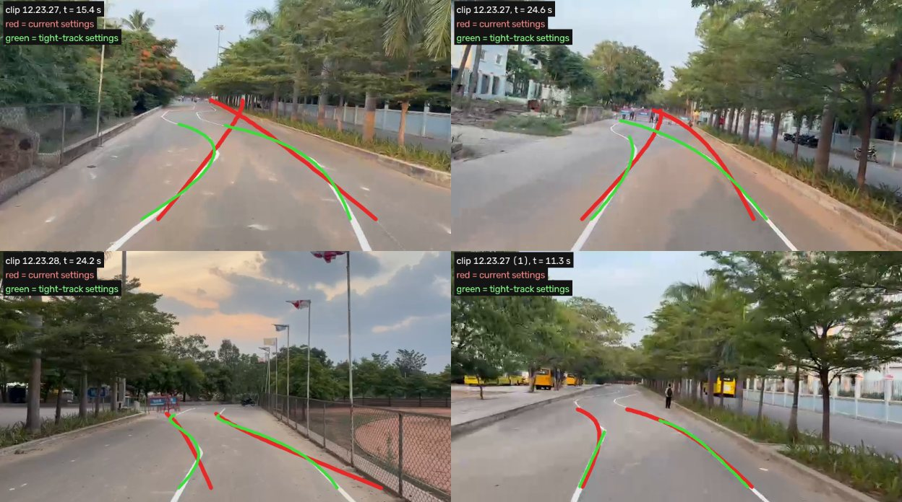

# aBaja 2026 Lane Keeping Assist (LKA) — how it works

This document explains the LKA in `models/LKA_Controller.slx`. The LKA takes the
output of a lane detector and turns it into a **turning radius** for the vehicle,
and from that into a road-wheel steering angle.

Every number quoted here comes from `src/utilities/lka_build_params.m`.

---

## 1. Conventions

| Item | Convention |
|---|---|
| Frame | ISO 8855 vehicle frame: x forward, y left, yaw counter-clockwise positive |
| Lane reference point | Rear-axle centre. This is the point a bicycle model turns about, so `R = 1/κ` is exact there |
| Signs | Positive curvature, steering angle or turning radius means turning **left** |
| Units | SI and radians inside the LKA. Converted to degrees only at the interface to `aBaja2026.slx` |
| Rate | Everything runs at `LKA.Ts = 0.05 s` (20 Hz), the same rate as the detector frames and the skeleton step |

---

## 2. Architecture

```
            ┌──────────────────────── LKA_Controller.slx ─────────────────────────────────────────┐
LaneSensor ─►│ Lane Perception ──► LaneEstimate ─┬─► LKA Supervisor (Stateflow) ── Active ──┐   │
 (L+R lines) │  validation, centre fusion,       ├─► Lane Departure Warning (DLC/TLC)       │   │
Speed ──────►│  Kalman tracker, latency comp.    └─► Lateral Controllers                    │   │
YawRate ────►│                                        • Pure Pursuit (+FF, +I)  ┐           ▼   │
Enable ─────►│                                        • Stanley 2025 baseline   ├─► κ_req ──►... │
             │                                        • MPC (QP, preview)       ┘                │
             │   ... ► Curvature Limiter (a_y, jerk) ─► κ_cmd ─► Steering Command δ = atan(κ(L+K_us v²))
             │       ─► Steering Actuator Manager (authority ramp, ±32°, 60°/s, 5 Hz LPF) ─► δ_cmd
             │       ─► Turning Radius  R = 1/κ_out,  κ_out = tan(δ_cmd)/(L + K_us v²)        │
             └──────────────────────────────────────────────────────────────────────────────────┘
Outputs: SteerCmd [rad], TurnRadius [m], LkaInfo (25 signals), LaneEstimate
```

All of the algorithm code lives in `src/`. The Simulink MATLAB Function blocks
call those same files, so the unit tests (`tests/unit_tests/test_lka_core.m`)
test exactly the code the model runs.

### 2.1 Input: the lane detector message (`LaneSensorBus`)

The detector reports each ego-lane boundary (`Left` and `Right`) as a clothoid
in the vehicle frame. This is the same representation Automated Driving Toolbox
uses for lane boundaries:

```
y(x) = LateralOffset + tan(HeadingAngle)·x + Curvature·x²/2 + CurvatureDerivative·x³/6
```

Each boundary also carries a `Strength` (0 means not detected) and a
`ViewRange`. Any lane detector can drive the LKA if it fills this bus:

- the emulated detector (`models/VirtualLaneSensor.slx`)
- a future port of the Asterix sliding-window detector
- a deep-learning detector

The 2025 detectors output pixels or annotated images only. The Asterix detector
outputs metric offset and radius but no heading.

### 2.2 Lane Perception

1. **Boundary validation** (`lka_validate_boundaries.m`). A boundary is used only if:
   - its strength is at least 0.3;
   - it is on its own side of the vehicle, with 0.5 m tolerance so a vehicle touching a line keeps that line;
   - its heading is within 35° and its curvature within 0.1 1/m;
   - its offset has not jumped by more than 0.6 m since the last accepted frame.

   When both boundaries pass, the implied lane width must lie between 2.5 and
   5.0 m. If it doesn't, the weaker boundary is dropped.
2. **Lane width estimator.** A first-order filter with τ = 2 s. It updates only
   while both lines are valid.
3. **Lane-centre fusion** (`lka_estimate_lane_center.m`):
   - Each boundary is moved half a lane width towards the centre, along the
     lane normal, and its curvature is converted to the centreline radius:
     `κc = κL/(1+κL·w/2)` or `κR/(1−κR·w/2)`.
   - The two estimates are averaged, weighted by detection strength, as in the
     MathWorks "Estimate Lane Center" reference design.
   - If only one line is seen, the centre is still produced but its measurement
     noise is doubled.
4. **Lane state tracker** (`lka_lane_tracker_step.m`) is a Kalman filter on
   `x = [y, ψ, κ, κ']`, the lane centre as seen from the rear axle. Its motion
   model is exact for a rear axle with no side-slip:
   ```
   ẏ = v·ψ      ψ̇ = v·κ − r      κ̇ = v·κ'      κ̇' = noise
   ```
   - The measured yaw rate `r` is the input, so the filter dead-reckons the lane
     through detector dropouts.
   - Outliers are rejected with a χ² gate on offset and heading. After 4
     consecutive rejections the filter re-initialises.
   - Curvature is not gated, because arcs in the official track join without
     transition spirals.
   - It outputs a quality value of `1 − σ_y/0.4 m`.
5. **Latency compensation** (`lka_lane_predict.m`). Detector frames are 50 ms
   old. The estimate is predicted forward by that latency with the same motion
   model (ego-motion compensation).

### 2.3 LKA Supervisor (Stateflow `LKA Mode Logic`)

| State | Steering authority | Entered when |
|---|---|---|
| OFF | none | `enable` false |
| STANDBY | none | enabled, but speed or lane not OK |
| ACTIVE | yes | speed within 0.5–12 m/s (hysteresis 0.2), lane quality ≥ 0.6 (hysteresis 0.3), last detector measurement ≤ 0.25 s old, and road curvature within steering capability |
| DEGRADED | yes, on the tracker's prediction | the lane is lost while ACTIVE: no measurement for more than 0.25 s (5 frames), or quality too low |
| TAKEOVER | none, take-over request | the lane has been lost for more than 1.0 s. Returns to STANDBY after 2 s once the lane is back |

The activation conditions are Simulink blocks: Relay blocks for the hysteresis
and Compare blocks for the limits. The chart only sequences the modes.

### 2.4 Lane Departure Warning

`lka_lane_departure.m` evaluates both axles. It compares the outer edge of each
tyre with the inner edge of the painted line. This is the rulebook criterion
(K.2.4): a wheel touching the line counts as outside the lane. From this it
gives:
- distance to line crossing (DLC);
- time to line crossing (TLC), using the lateral rate of the lane centre at the axle, `v·ψ + x·(v·κ − r)`.

A warning is raised when DLC < 0.15 m or TLC < 0.8 s. The warning is computed
and logged but does not change the steering.

### 2.5 Lateral controllers: lane estimate → curvature (= 1 / turning radius)

All three controllers run in parallel every step. `LKA.ControllerSelect` picks
which one steers. The others run in shadow mode for comparison.

**1. Pure pursuit with curvature feed-forward (main controller, `lka_pure_pursuit.m`)**

The target point lies on the estimated lane centre, `L_d` ahead of the rear axle:
```
y_T = y + ψ·L_d + κ·L_d²/2 + κ'·L_d³/6
```
The circular arc from the rear axle (tangent to the vehicle heading) through
that point has curvature
```
κ_PP = 2·y_T / (L_d² + y_T²)          turning radius  R = 1/κ_PP
```
For small errors this expands to
```
κ_PP ≈ κ  +  (2/L_d)·ψ  +  (2/L_d²)·y  +  κ'·L_d/3
       │       │             │
       │       │             └ proportional action on lateral offset
       │       └ proportional action on heading (damping)
       └ road-curvature feed-forward (follows the curve with zero error)
```
So pure pursuit on the detected lane is a feed-forward-plus-PD controller, and
both gains come from one physical knob, the look-ahead distance `L_d`:
- `L_d` comes from a 1-D lookup table on speed: 4.0 m at standstill, 6.0 m at 30 km/h, 8.5 m at 50 km/h
  (never below 3.5 m; a shorter low-speed look-ahead over-steers a crooked start, see §8, S5).
- It is shortened in curves by `L_d/(1 + 1.5·|κ|·L_d)` to limit corner cutting.

A small integral term removes any steady offset that unmodelled understeer
leaves in long curves:
- `κ_I = 0.002·∫y dt`, limited to ±0.004 1/m;
- it runs only while active, not saturated, and above 2 m/s;
- it resets when the LKA is inactive.

**2. Stanley + PID, aBaja 2025 baseline (`lka_stanley_2025.m`)**

This is the 2025 `ros2_ws/.../lka.py` law ported with every gain unchanged:
- `δ = ψ_chord + atan2(0.3·min(2, v/5)·cte, v + 1) + PID(cte)`
- ψ_chord is the heading of the chord to a look-ahead point `6 + 0.4·v` m ahead;
- 0.1 m deadzone; PID gains 0.015 / 0.001 / 0.005, clipped to ±3°;
- ±12° limit, 25°/s rate limit, smoothing factor 0.7.

The one change is the 2025 frame bug: there, world-frame vehicle positions were
compared with vehicle-frame lane points, giving cross-track errors of −249 to
−300 m. The port takes every error from the vehicle-frame lane estimate.

**3. Linear time-varying model predictive control (`lka_mpc_curvature.m`)**

Prediction model, with the speed varying along the horizon:
```
ė_y = v_k·e_ψ      ė_ψ = v_k·(κ_v − κ_road)      κ̇_v = (κ_cmd − κ_v)/τ_steer
```
- The model is discretised exactly (zero-order hold) at every horizon step.
- The predicted speed follows the measured acceleration, `v_k = v + a·k·Ts`.
- 30 steps (1.5 s), with the road-curvature preview taken from the lane clothoid.
- Cost: `Σ 100·e_y² + 1000·e_ψ² + 1000·(κ_cmd − κ_road)² + 5e5·Δκ_cmd²`.
- The constraints are applied per step at that step's speed, and are the same
  envelope the curvature limiter applies: `|κ| ≤ κ_max(v_k)` and
  `|Δκ| ≤ κ̇_max(v_k)·Ts`.
- Solved each step as a quadratic program with `mpcActiveSetSolver`,
  warm-started from the previous active set.
- The state κ_v is the measured path curvature `r/v`. The rate constraint
  starts from the MPC's own previous command, so the MPC stays self-consistent
  in shadow mode and during the authority ramp.

What it took to get here:
- **The MPC Toolbox "Lane Keeping Assist System" block was tried first and
  rejected.** It is tuned for a 1575 kg sedan, has no steering-rate constraint,
  and was unstable against the jerk limit on the 240 kg Baja (lateral errors up
  to 220 m).
- **A constant-speed version of this MPC over-steered during the launch from
  standstill.** It drove the car out of the lane on S3 and S5. The time-varying
  speed profile, the yaw-rate state and the self-referenced rate constraint fixed this.
- **The weights stay stable with up to 200 ms of unmodelled loop delay** in an
  offline closed-loop sweep.

### 2.6 Curvature limiter → steering → actuator manager

1. **Curvature limiter.** Limits the curvature magnitude to
   `κ_max = min(3/v², tan(32°)/(L + K_us·v²))` and the curvature rate to
   `min(5/v², 60°/s / (L + K_us·v²))`. These caps are 3 m/s² lateral
   acceleration and 5 m/s³ lateral jerk, the UNECE R79 ACSF B1 values, plus the
   steering hardware limits.
2. **Steering command.** `δ = atan(κ·(L + K_us·v²))`. This is steady-state
   single-track steering with understeer gradient
   `K_us = m/L·(b/C_f − a/C_r)`, and it reduces to Ackermann `atan(L·κ)` at low
   speed.
3. **Actuator manager**:
   - an authority ramp of 0.5 s on activation and deactivation (bumpless);
   - limits of ±32° and 60°/s (Asterix hardware);
   - a 5 Hz output low-pass filter;
   - a saturation flag that freezes the pure pursuit integrator (anti-windup).
4. **Turning radius output.** `κ_out = tan(δ_cmd)/(L + K_us·v²)` and
   `R = 1/κ_out`, positive to the left. It is clipped to ±1000 m when driving
   straight. This is the radius the vehicle actually drives with the commanded
   steering, after all limits.

---

## 3. Test bench (`models/LKA_MIL_TestBench.slx`)

| Block | Model |
|---|---|
| Scenario | Driver speed profile `v = min(a·t, v_set)` and forced detector outages |
| Steering actuator | 60°/s rate limit, ±32°, 0.1 s first-order lag (the same lag as the skeleton's Delayed Steering System) |
| Vehicle | Nonlinear single-track Baja (`vehicle_params.m`: 240 kg, L = 1.45 m) with saturating tyres `μFz·tanh(Cα/μFz)`, blended to the kinematic model below 3 m/s |
| Lane geometry | The official track read directly from `LKA_IPG.xodr` (`read_xodr_lane.m`: lane 1, 3.5 m, left-hand traffic) |
| Virtual Lane Sensor | 20 Hz frames, 50 ms latency, Gaussian noise (σ: 3 cm, 0.3°, 4e-4 1/m), 1 % random misses per line |
| Ground truth metrics | CG offset, heading error, the four tyre-to-line margins, all-tyres-in-lane flag |

Scenarios (`generate_lka_scenarios.m`):
- **S1:** official track, 0 → 30 km/h at 4 m/s², 60 s.
- **S2:** official track at 33 km/h, the disqualification threshold.
- **S3:** a rulebook-style tight track with the 2025 sample-track radii (R 50 / 60 / 85 m).
- **S4:** degraded detector: 3× noise, 100 ms latency, and outages of 0.6 s on both lines in a curve, 3 s on one line, and 1.5 s on both lines (which triggers a take-over request).
- **S5:** start 0.8 m off-centre with a 4° heading error.

Run it all with:
```matlab
run('config/startup.m')
results = run_lka_mil();                 % 5 scenarios × 3 controllers, figures + KPI table in results/mil
results = run_lka_mil(Scenarios={'S1_Nominal'}, Controllers=1);
```

## 4. Results

See `results/mil/lka_mil_kpis.csv` and the figures in `results/mil/`
(`*_overview.png`, `*_perception.png`, `*_comparison.png`). A summary is in
section 6.

## 5. RoadRunner co-simulation (`aBaja2026.slx`)

`scripts/integrate_lka_into_skeleton.m` adds the root subsystem
"LKA (Lane Keeping Assist)" to the competition model:
- **Inputs:** the vehicle state, the closest route point and the route curvature, taken from `Subsystem2`.
- **Skeleton Pose Adapter:** converts the CG pose in degrees to the rear-axle pose in radians (for the emulated
  sensor and metrics only). The controller's yaw rate is the vehicle's `CurrYawRate` (`LKA.Cosim.YawRateSign`).
- **Lane Source** (variant subsystem, `LKA_LANE_SOURCE`): **1 = camera lane detector** on the skeleton's
  Simulation 3D Camera (submission configuration); 2 = emulated Virtual Lane Sensor (development only).
- **Ego Sensors:** wheel-speed and gyro models (scale error, bias, noise) in front of the controller.
- **Controller:** LKA_Controller with the `skeleton` profile (L = 3.0 m).
- **Output:** a road-wheel angle in degrees, positive to the left, into `Subsystem2/Controller_SteerCmd`.

That port is the steering source in LKA mode (Mode = 1) and Endurance mode
(Mode = 2). All other modes behave exactly as before.

## 6. Results summary (MIL, Baja profile, 2026-10-16)

Columns:
- **max |e|:** largest lateral offset of the CG from the lane centre.
- **min margin:** smallest distance from any tyre's outer edge to the inner edge of the line.
- **in lane:** share of time with all four tyres inside the lane lines.
- **jerk:** maximum 0.5 s moving-average lateral jerk.

| Scenario | Controller | max \|e\| [m] | RMS [m] | min margin [m] | in lane | max a_y [m/s²] | jerk [m/s³] |
|---|---|---|---|---|---|---|---|
| S1 official track, 30 km/h | **Pure Pursuit** | **0.098** | 0.023 | 0.83 | 100 % | 1.17 | 2.70 |
| | MPC | 0.101 | 0.025 | 0.83 | 100 % | 1.09 | 2.54 |
| | Stanley 2025 | 1.348 | 0.515 | −0.43 | 95.6 % | 2.99 | 5.00 |
| S2 official track, 33 km/h | **Pure Pursuit** | **0.154** | 0.030 | 0.77 | 100 % | 1.68 | 3.57 |
| | MPC | 0.158 | 0.033 | 0.77 | 100 % | 1.57 | 3.34 |
| | Stanley 2025 | 1.395 | 0.652 | −0.47 | 78.1 % | 2.99 | 5.00 |
| S3 tight R 50/60/85 m | **Pure Pursuit** | **0.393** | 0.101 | 0.53 | 100 % | 2.94 | 4.90 |
| | MPC | 0.315 | 0.099 | 0.60 | 100 % | 2.65 | 4.42 |
| | Stanley 2025 | 2.114 | 0.882 | −1.20 | 73.0 % | 2.99 | 5.00 |
| S4 degraded detector¹ | **Pure Pursuit** | **0.133** | 0.052 | 0.80 | 100 % | 1.18 | 2.99 |
| | MPC | 0.152 | 0.056 | 0.78 | 100 % | 1.10 | 2.66 |
| | Stanley 2025 | 0.430 | 0.139 | 0.49 | 100 % | 2.35 | 4.95 |
| S5 0.8 m / 4° initial offset | **Pure Pursuit**² | **0.882** | 0.130 | 0.015 | 100 % | 1.80 | 3.38 |
| | MPC | 0.900 | 0.140 | 0.001 | 100 % | 1.65 | 3.36 |
| | Stanley 2025 | 1.171 | 0.532 | −0.26 | 95.6 % | 2.99 | 5.00 |

² With the low-speed look-ahead of 2026-10-16 (4.0 m at standstill instead of 2.5 m; values
from 30 km/h up unchanged). Before: 0.873 m, a_y 2.45 m/s², jerk 4.86 m/s³, R 5 m command at
2 km/h. S1-S4 are unchanged.

¹ S4 contains a deliberate 1.5 s loss of both lines. The supervisor correctly
goes ACTIVE → DEGRADED (after 0.25 s) → TAKEOVER (after 1.0 s) → STANDBY → ACTIVE,
which is exactly one take-over request. The 0.6 s outage of both lines in a curve
and the 3 s loss of the left line are bridged without leaving ACTIVE/DEGRADED.

**About the 2025 baseline.** Inside the same safety envelope as the new
controllers (3 m/s² lateral acceleration, 5 m/s³ jerk), the 2025 Stanley law
falls into a limit cycle: the jerk-rate limit adds phase lag the law was not
designed for. Without the envelope, as it ran in 2025, it stays in the lane on
S1 but still has 0.33 m maximum and 0.13 m RMS error, about 3× worse than pure
pursuit, and it exceeds the jerk limit (5.46 m/s³).

**Turning radius.** On the official track the commanded turning radius follows
the road radius (R 257 m and R 127 m arcs). Its minimum magnitude is 54 m
(pure pursuit, S1), reached at the curve reversals where the controller
anticipates the next arc. On the straights the output alternates around ±1000 m
(straight ahead) with the detector noise.

### Diagrams

| | |
|---|---|
| LKA_Controller (top level) |  |
| Lane Perception |  |
| Supervisor state machine |  |
| Lateral controllers |  |
| Pure pursuit |  |
| MPC |  |
| Curvature limiter |  |
| Steering actuator manager |  |
| Emulated lane detector |  |
| MIL test bench |  |
| Integration in aBaja2026.slx |  |

## 7. Known limitations and next steps

1. **RoadRunner co-simulation has not been run.** RoadRunner is not installed,
   and `aBaja2026.slx`'s `InitFcn` needs a live `rrSim`. The integration
   compiles cleanly with a substituted start pose. The first co-simulation run
   should check the sign of the skeleton pose and yaw (`LKA.Cosim.YawOffsetDeg`)
   and that the route runs along the lane centre.
2. **Camera lane detection is in place** (section 8). The team UFLDv2 and YOLOP run
   on the GPU through the ONNX importer add-on (about 32 / 38 ms per frame; Python
   onnxruntime on the CPU stays as the fallback). YOLOP detects the rendered left line in
   only 31 % of the frames (BDD100K model, sim-vs-real gap) but completes the closed loop.
   The skeleton camera extrinsics (hood centre) are checked in the RoadRunner run.
3. **The emulated detector reports curvature at the vehicle position only.** It
   gives no preview of curves still ahead in the camera view. A real
   polynomial-fit detector would add preview, which helps pure pursuit and MPC
   at curve entries.
4. **The Baja parameters need confirming.** `vehicle_params.m` (L = 1.45 m,
   240 kg) differs from the 2025 CarMaker Baja (L = 1.341 m, about 347 kg).
5. **The MPC's QP solve is slower to simulate** than pure pursuit. A
   referenced-model rebuild takes about 60 s; after that, runs are fast.

## 8. Camera lane detection (rule I.2.3)

The aBAJA 2027 rulebook (I.2.3) does not allow ground-truth or road-state sensors as
inputs to the final algorithm. The submission configuration therefore gets the lane
from the camera:

```
Simulation 3D Camera (1280x720, f = 1109 px)
  -> detector (LKA.Vision.Detector: 'yolop' | 'cnn' (team UFLDv2) | 'classic')
  -> lane-line probability map (one contract for every detector, models/perception/README.md)
  -> metric bird's-eye view (monoCamera / birdsEyeView, 5 cm cells, 30 m ahead, +-6 m)
  -> sliding-window search per line (continuity prior +-0.45 m, cold window +-1.3 m)
  -> robust (Huber IRLS) polynomial fit in metres -> LaneSensorBus (rear-axle clothoid)
  -> one frame processing latency -> LKA_Controller (unchanged)
```

**Camera model.** For pitch θ (down positive), height h and camera position
(x_c, y_c), a pixel (u, v) gives the ray d = o + x_n·r + y_n·d_n with
o = (cos θ, 0, −sin θ), d_n = (−sin θ, 0, −cos θ), r = (0, −1, 0),
x_n = (u − c_x)/f, y_n = (v − c_y)/f. It meets the flat road at p = c + (h/−d_z)·d.
`monoCamera` implements exactly this; `test_vision_camera.m` checks it against the closed form.

**Main parameters** (`src/vision/lka_vision_params.m`):

| Group | Parameter | Value |
|---|---|---|
| Bird's-eye | resolution / range / half-width | 0.05 m / 30 m / 6 m |
| Search | slice / cold window / warm window / max gap | 1 m / ±1.3 m / ±0.45 m / 8 m |
| Fit | linear < 8 m span ≤ quadratic < 15 m ≤ cubic, Huber δ | 0.08 m |
| Tracking | prior age / width re-seed / width tolerance | 0.3 s / 10 frames / ±0.6 m |

**Fixes over the 2025 pipeline** (`docs/adas2026_audit.md`):
- a calibrated, metric bird's-eye view instead of the hand-tuned trapezoid;
- a distance-gated search window;
- only direct fits become the next prior;
- width re-seeding;
- one-line operation and coasting left to the existing Kalman tracker and supervisor.

**Accuracy on synthetic frames:** offset 1–3 cm, heading ≤ 0.4°, 8 ms per frame.

**Camera-in-the-loop on the official track** (`LKA_Vision_TestBench`, Unreal, `LKA.usd`;
S1, 0 → 30 km/h, pure pursuit, classic detector):

| Max lateral offset | RMS | Min tyre-to-line margin | In lane | Both lines found | Detector |
|---|---|---|---|---|---|
| 0.079 m | 0.043 m | 0.85 m | 100 % | 99.9 % of frames | 31.6 ms/frame |

**Detector benchmark and closed loop** (241 recorded official-track frames, then one closed-loop
S1 run per detector; `run_detector_benchmark`):

| Detector | Back end | Lines found L / R | Boundary error at 10 m | Detector time |
|---|---|---|---|---|
| team CNN (UFLDv2, fit to 18 m, ego-lane pages) | importer, GPU | 99.6 % / 99.6 % | 6.3 cm | 32 ms |
| classic | MATLAB, CPU | 99.6 % / 99.6 % | 7.1 cm | 19 ms |
| YOLOP (2025, RGB input, fit to 15 m) | importer, GPU | 31 % / 90 % | 9.4 cm | 38 ms |

Camera closed loop on the official track (`run_lka_vision`, pure pursuit, 2026-10-16, max / RMS
lateral offset, min tyre-to-line margin, time with all tyres in lane):

| Scenario | team CNN | classic | YOLOP |
|---|---|---|---|
| S1 0 → 30 km/h | **0.031 / 0.012 m**, 0.91 m, 100 % | 0.086 / 0.044 m, 0.85 m, 100 % | 0.122 / 0.058 m, 0.81 m, 100 % |
| S2 0 → 33 km/h | **0.049 / 0.014 m**, 0.89 m, 100 % | 0.106 / 0.046 m, 0.83 m, 100 % | 0.155 / 0.054 m, 0.77 m, 100 % |
| S5 start 0.8 m left, 4° | **0.882 / 0.129 m**, 0.015 m, 100 % | 0.882 / 0.134 m, 0.014 m, 100 % | 1.402 / 0.365 m, −0.46 m, 93.5 % |

S5 maximum = the start offset itself. S3 (a different, tighter track) and S4 (degradations of the
emulated detector) have no Unreal scene / no meaning for the camera and run in MIL only.

**S5 with the camera used to fail** (car swung out into the next lane: max 3.99 m, 10 % in lane
with the CNN; the classic run left the road). The low-speed look-ahead was 2.5 m: with a 1 m
lane-centre error while the car pulls away, pure pursuit asked for R 4 m at 2 km/h, the heading
swung by ±13°, and with frames where the far line was not seen the swing grew. The look-ahead
now starts at 4.0 m (minimum 3.5 m, unchanged from 30 km/h up); MIL S1-S4 are unchanged.

(Earlier on 2026-10-16 the classic S1 run moved from 0.079 to 0.090 m when the bird's-eye
warp changed from `transformImage` to `lka_bev_warp`: both give the same map to 1e-7, but the
closed loop amplifies such differences over 60 s.)

**YOLOP input bug (ADAS_2026).** YOLOP was trained on RGB (its `AutoDriveDataset` converts
BGR to RGB), but YOLOP's `demo.py`, and the ADAS_2026 port taken from it, feed BGR. With
BGR the lane head stayed at its 0.41 floor on the rendered road: left line found in 4 % of the
frames, and the car left the road. `models/perception/yolop.json` now says `RGB`
(`test_vision_assets` guards it).

**Team CNN = Colab.** `tools/ufld_reference.py` runs the team model exactly as the Colab /
`demo.py` (PIL + torchvision transforms, onnxruntime, original `pred2coords`).
`test_ufld_reference_parity` compares it with MATLAB on college-track and synthetic frames:
same lane slots, lane points within 0.06 px. The accuracy measured in Colab (TuSimple
test set) therefore holds in MATLAB for the same kind of images; a different road (rendered
track, college snake lane) is a different domain, not a MATLAB difference.

**Ego-lane pages.** UFLDv2 orders its four lane slots left to right (slot 2 = ego-left,
slot 3 = ego-right). `lka_detector_ufld` returns one probability page per ego line and the lane
search reads only its own page, so a kerb or the next lane (slots 1 and 4) cannot be taken
for an ego line. A page falls back to all lanes when its slot is empty.

The ground truth is the OpenDRIVE lane border. On this track the paint sits off it: the edge
line is about 0.13 m outside, and the inner stripe of the double centre line about 0.15 m
inside. Part of the boundary error is therefore common to every detector, and the camera keeps
the car centred between the painted lines. The USD export carries no semantic lane class,
so F1/IoU are only computed on the synthetic dataset.

**Team UFLDv2 range limit.** On the tighter R127 S-curve the network bends its far lane points
the wrong way: heading error σ 10°, and curvature anti-correlated with the truth. With the full
30 m fit the car oscillated and left the lane. Fitting only up to 18 m ahead (`max_range_m` in
`models/perception/cnn.json`) brings it to σ 1.8°, the same level as the classic detector.

**Frame rate.** Camera, detector and controller run at a fixed 20 Hz (one frame of latency
modelled, compensated by the Kalman filter). Per-frame processing on the RTX 4050 laptop,
1280x720 camera (`measure_lka_timing`, median):

| Stage | Time |
|---|---|
| team CNN on the GPU (resize, network, decode, raster) | 32 ms |
| YOLOP on the GPU | 38 ms |
| classic detector (CPU) | 19 ms |
| bird's-eye warp (`lka_bev_warp`) | 2 ms |
| lane search + robust fit | 5-12 ms |
| annotated video (recorder only) | 34 ms |

The CNN chain is about 40 ms, inside the 50 ms frame budget (was 68 ms on the CPU). In the
Unreal closed loop, which shares the GPU with the renderer, it measures 41-49 ms per frame.
The MIL bench (no camera) runs 1.4x faster than real time.

**GPU use.** The networks are imported once (`lka_import_onnx_detector`, cached as
`models/perception/*_dlnetwork.mat`) and optimised: HardSwish chains fused into one layer each
(YOLOP 303 → 156 layers, identical output), the UFLDv2 batch-size check removed so recorded
videos run 8 frames per network call. Weights stay on the GPU, `predict` uses
`Acceleration="auto"`, resizes are two cached matrix products on the GPU
(`lka_resize_pages`: 1 ms instead of 11 ms for `imresize` on a gpuArray), and the bird's-eye
warp and the visual odometry run batched on the GPU. Further gains need GPU Coder with the
CUDA Toolkit, cuDNN and TensorRT (not installed); the NVIDIA "Prefer maximum performance"
power mode avoids the clock ramp-up between frames on a laptop.

**GPU memory.** Unreal and the network share the 6 GB of the RTX 4050. With little free
memory Unreal stops at start-up with "3D Simulation engine was terminated by the user
(error code: 4)". `run_lka_vision` warns below 2.5 GB free; clear old detectors and run
`reset(gpuDevice)`.

**Known model limitation.** A single polynomial fitted across a straight-to-arc transition
biases the extrapolated heading at the rear axle (about −1.3° with an arc 22 m ahead). The
near-range geometry that pure pursuit uses stays accurate, as the closed-loop result above shows.

## 9. Recorded track videos (`run_lka_on_video`)

Runs the same camera chain and the unchanged `LKA_Controller` on a video, for example the
organisers' track video or a phone recording of the college track:

```matlab
run_lka_on_test_videos                       % every vids/*.mp4 -> test_res/<name>/ + summary.csv
run_lka_on_video('vids/clip.mp4', Detector='cnn', Camera='auto', HFovDeg=70, CameraHeight=1.2)
```

1. **Camera.** With `Camera='auto'` the intrinsics come from the field of view (phone main
   camera about 70°), the pitch from lane-line parallelism (`lka_autocalibrate_camera`). One
   scale is needed: the lens height (`CameraHeight`, default 1.2 m) or the lane width
   (`LaneWidth`). A single camera cannot tell a narrow lane seen from low down from a wide
   lane seen from high up.
2. **Pass 1 (GPU, 8 frames per call):** detection, bird's-eye warp, lane search and fit,
   visual odometry (FFT correlation of the road texture between frames: speed and yaw rate).
3. **Controller replay** (`lka_replay_controller`): `LKA_Controller` runs open loop on the
   lane estimates: steering, turning radius and LKA state are what the LKA *would* command.
   The car in the video does not react.
4. **Outputs** in `test_res/<name>/`: `lka_video_annotated.mp4` (ego lane, raw CNN lane points,
   lane centre, commanded path, HUD, steering bar, bird's-eye inset), `lka_video_overview.png`
   (lane position, heading, radius, steering, speed, yaw), `lka_video_path.png` (dead-reckoned
   path with the detected lines), `lka_video_results.csv` (one row per frame, with time per
   stage), and `test_res/summary.csv`.

College-track clips (2026-10-16, team CNN, GPU, about 30 ms per frame):

| Clip | Lane width | Both lines | LKA active | Distance | Max speed |
|---|---|---|---|---|---|
| 12.23.27 | 2.07 m | 91 % | 96 % | 50 m | 16 km/h |
| 12.23.27 (1) | 1.90 m | 90 % | 85 % | 58 m | 18 km/h |
| 12.23.28 | 2.09 m | 60 % | 94 % | 63 m | 19 km/h |

**Limits.**
- Speed and yaw from visual odometry are estimates: about ±20 % on these low-resolution
  (832x464) clips, because a camera-pitch error scales far distances. A GPS or wheel-speed log
  (`SpeedLog`) or a measured camera height and field of view remove most of it.
- On clip 12.23.28 the painted snake lane is narrower than the road. The CNN, trained on
  TuSimple highways, often labels the road edges as the ego lane there, and the driver also
  cuts across the painted lines. Fine-tuning the team model on about 200 labelled frames of
  the college track is the real fix.
- The video tool sets the controller's lane-width band from the measured width
  (`lka_set_lane_width`). For a live test on another track, set `lkaLaneWidth` (for example
  `lkaLaneWidth = 2.0;`) before `run('config/startup.m')`.
- Tried and rejected: moving every CNN lane point onto the white paint under it and dropping
  points without paint. In Unreal the closed loop got worse (0.094 m instead of 0.037 m:
  the double centre line and the paint lying off the lane border), and on clip 12.23.28 both
  lines were found in 42 % of the frames instead of 60 % (the college kerb is painted white
  too).

### 9.1 Tight tracks: why the college lane came out straight (fixed 2026-10-16)



**Symptom.** On the three college clips the detected lane (green area in the annotated videos)
stayed almost straight while the painted snake lane bends at R ≈ 3–8 m. The detected curvature
was 10–20 % of the real one, and on clip 12.23.27 one fitted line in ten was more than 1.6 m off
the paint 9 m beyond the first visible road row.

**Cause.** Every camera setting was tuned for the official track (3.5 m lanes, R 127 m and
257 m). On a 2 m lane with R 3–8 m S-bends five of them straighten the lane, and they add up:

| # | Setting (official values) | Effect on the snake lane | Where |
|---|---|---|---|
| 1 | Fit degree from the span: line < 8 m ≤ parabola < 15 m ≤ cubic | One parabola over 4–20 m averages two or three bends to ~0 curvature. **The main cause.** | `lka_fit_boundary.m`, `Fit.QuadSpan`, `Fit.CubicSpan` |
| 2 | Next search window from a straight line through the last 6 peaks | The search leaves a tight bend after a few slices and stops; only the straight start is fitted. | `lka_search_boundary.m` |
| 3 | `Track.CurvatureMax` and `Val.CurvatureMax` = 0.1 1/m (R ≥ 10 m) | A correct fit of a tighter bend would be thrown away, twice. | `lka_vision_params.m`, `lka_build_params.m` |
| 4 | Heading / curvature checked at the rear axle | 4–6 m of extrapolation behind the first visible row exaggerates both on a tight bend. | `lka_vision_lane_step.m` |
| 5 | Controller checks side, width and jumps at the rear axle | With 1–4 fixed it still dropped one or both lines in 23–63 % of the frames. | `lka_validate_boundaries.m` |

Not causes (checked): the lane Kalman filter (400× more curvature process noise changed the
lane-centre curvature by < 1 %), and the curvature gates alone (the fit never produced a curvature
above them).

**Fix.** `lka_set_track_profile(LKA, 'tight', MinRadius=3)` switches all five; the defaults are
unchanged, so the official track and every result above stay as they were (checked: the edited
functions give bit-identical outputs with the default settings on 36 synthetic frames). The video
tool uses the tight profile by default (`TrackProfile='official'` for a video of the official track).

| Setting | Official (default) | Tight |
|---|---|---|
| Fit degree | parabola ≥ 8 m, cubic ≥ 15 m | parabola ≥ 3 m, cubic ≥ 6 m |
| Fitted range | whole search | cut back 1 m at a time until the line centre (every 0.5 m) is within 4 cm of the fit for 90 % of the range (`Fit.AdaptiveRange`, `Fit.MaxResidual`, at least 5 m); paint width and noise average out |
| Search prediction | straight line | parabola (`Search.PredictQuadratic`), window +0.15 m per missed slice |
| Curvature gates | 0.1 1/m | 1 / (0.8 · MinRadius) = 0.42 1/m |
| Camera chain checks | at the rear axle | at the first visible row (`Track.CheckAtNear`), heading ≤ 50° |
| Controller checks | at the rear axle, jump 0.6 m | 4 m ahead (`Val.CheckX`), jump 1.0 m |

**Result** (Python replica of the camera chain with the classic detector on the three clips, against
the painted line traced without a curve model; the MATLAB run with the team CNN must be repeated):

| Clip | Fit vs paint, 90th percentile, 3 / 5 m past the first visible row | Lane-centre curvature, 90th percentile | Both lines accepted by the controller |
|---|---|---|---|
| 12.23.27 | 0.17 / 0.42 m → **0.05 / 0.15 m** | 0.038 → **0.147** 1/m | 69 % → **94 %** |
| 12.23.27 (1) | 0.06 / 0.07 m → **0.03 / 0.02 m** | 0.020 → **0.092** 1/m | 89 % → **94 %** |
| 12.23.28 | 0.17 / 0.22 m → **0.03 / 0.05 m** | 0.035 → **0.150** 1/m | 47 % → **81 %** |

The tight fits stop where one cubic can no longer follow the paint (`ViewRange`), so the preview is
shorter: on clip 12.23.27 the fit reaches 7 m past the first visible row in about 40 % of the frames
(the other clips: 69–96 %). The annotated video now draws each line only up to its `ViewRange`.

**So it cannot come back unnoticed.**
- `tests/unit_tests/test_vision_tight_track.m`: synthetic snake lanes (no camera toolbox); fails if a
  tight lane is fitted straight, or if the default settings stop reproducing the official behaviour.
- Straight-lane alarm: every video frame gets `LeftShapeError_m` / `RightShapeError_m`, the largest
  distance between the fitted line and the painted line traced without a curve model
  (`lka_lane_shape_error.m`, `lka_trace_line.m`). `test_res/summary.csv` gets `ShapeErrorP90_m` and
  `StraightAlarm` (> 0.25 m), and the video tool warns.
- `run_lka_checks(Level='full')` runs the tests and every video and fails on an alarm.

**Remaining limits.** The phone camera sees the road from 4–6 m ahead of the rear axle; on a bend
tighter than about R 6 m the lane leaves the image sideways before the camera sees it. A higher or more
tilted mount or a wider lens helps more than any software setting. The lane-centre fusion
(`lka_estimate_lane_center.m`) still shifts each line by half a lane width with the heading at the
rear axle, an approximation on tight bends. The CNN (TuSimple) still cuts corners; fine-tuning is
`team_actions.md` item 8.

### 9.2 Automation

| Command | What it does |
|---|---|
| `run_lka_pick_video()` | File dialog → run → overview figure and annotated video open. For newcomers. |
| `watch_lka_videos()` | Background watcher: every video copied into `vids/` is processed within 30 s (`Stop=true` to end). |
| `run_lka_checks()` / `run_lka_checks(Level='full')` | Unit tests (+ MIL closed loop + all videos with the straight-lane alarm), report in `results/checks/`. |
| `tools\run_lka.bat [videos\|watch\|checks\|full]`, `tools/run_lka.sh` | The same without opening MATLAB (`matlab -batch`); schedule `watch` or `full` with Windows Task Scheduler or cron. |

## 10. Live dashboard

```matlab
start_lka_dashboard        % http://127.0.0.1:8050, opens the browser
```

`tools/lka_dashboard.py` (Python standard library, 127.0.0.1 only) shows the running job:
the video tool or the Unreal bench, published by `lka_monitor_publish` into
`results/monitor/`. The page shows:
- the annotated camera frame and the progress;
- the LKA state, speed, steering, turning radius, lane centre and heading;
- the time per pipeline stage;
- charts of steering, lane lines, speed and timing;
- the GPU from `nvidia-smi`: load, memory, temperature, power and clock;
- the finished results (`test_res/summary.csv`, `results/vision/lka_vision_kpis.csv`), with the
  annotated videos and graphs in a viewer.

Telemetry is throttled (JSON every 0.2 s, frame every 0.4 s) and can be switched off with
`Monitor=false` (`run_lka_on_video`, `run_lka_vision`) or `LKA.Vision.Monitor = false`.

## 11. Legacy Stanley path (`stanley_steer_control`, ISO 11270 test)

The scaffold's Stanley law damped the absolute yaw rate (`-k_yaw*r`). In a steady R 50 m bend
at 30 km/h that is about 10° of steering out of the bend, which the cross-track term could
only cancel with about 1.5 m of offset, failing `test_iso_11270_compliance` (limit 0.35 m).
With the path curvature it now damps `r - v*kappa` and feeds `atan(L*kappa)` forward
(Hoffmann et al., 2007); the ISO test passes. Without curvature the law is unchanged.
