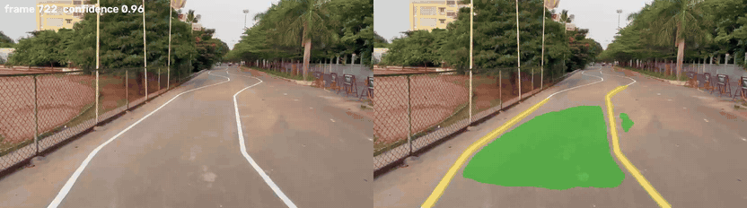
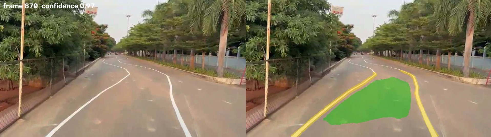
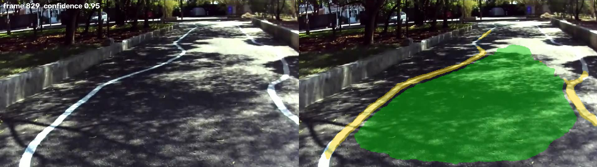
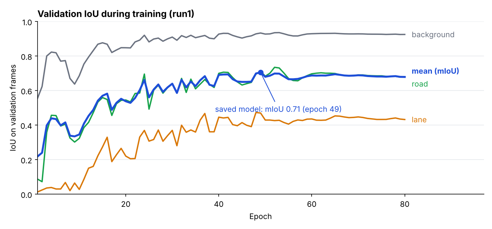
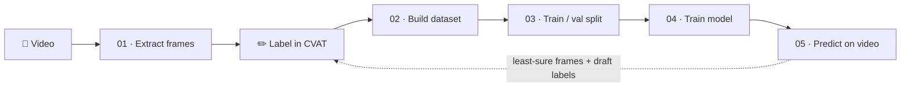
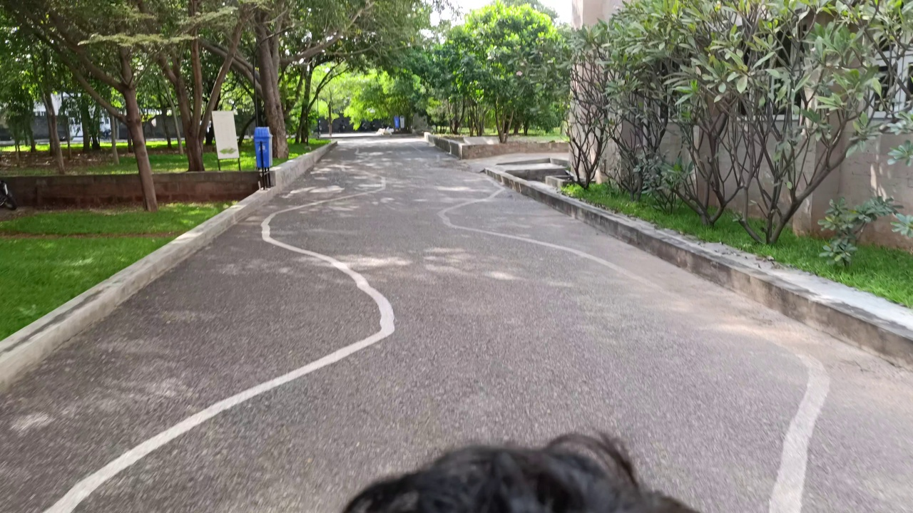
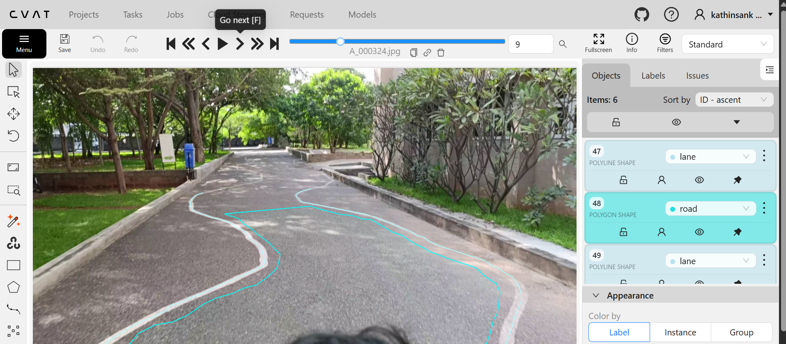
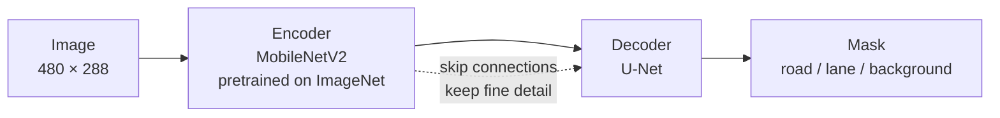

<div align="center">

# 🛣️ Lane Keep Assist

### Camera-based lane and road segmentation for an autonomous Baja buggy

**Team Asterix · Software & Perception · SAE India aBAJA 2027**




<sub>Left: camera video. Right: what the model sees. <b>Green</b> = road between the lines, <b>yellow</b> = lane lines.</sub>

</div>

---

## 📌 What is this?

Our buggy has to **steer itself and stay inside its lane**. Before it can steer, it has to *see* the lane.

This repository is that "seeing" part. A small neural network looks at each camera frame and labels every pixel as one of three things:

| Colour | Class | Meaning |
|:---:|---|---|
| 🟩 | **road** | the drivable area between the two lane lines |
| 🟨 | **lane** | the painted lane line |
| ⬛ | **background** | everything else: trees, grass, kerbs, walls |

The repository holds the whole workflow: cut a video into frames, label them, train the model, and test it on video.

## 🎯 Why we built it

In the aBAJA **Lane Keep Assist** event the vehicle steers itself at about 30 km/h inside a 3.5 m wide lane. The score depends on how long it stays inside, and the run is disqualified if all four wheels leave the lane. Reliable lane perception is the first requirement.

## 🖼️ Results

**A road the model was not trained on.** All training frames came from one campus video. This clip was recorded at a different place:



**Heavy tree shadows on a campus path.** Shadows are the hardest condition for us, because a shadow edge can look like a line:



<sub>The <code>confidence</code> number is the model's average certainty for that frame. It is not an accuracy score.</sub>

### Numbers

Measured on 8 hand-labelled frames that were kept out of training:

| Class | IoU |
|---|:---:|
| background | 0.93 |
| road | 0.71 |
| lane | 0.47 |
| **mean (mIoU)** | **0.71** |

IoU is the overlap between the model's answer and our hand label (1.0 is a perfect match). Lane lines score lowest because they are only a few pixels wide.



> [!NOTE]
> This is an **early prototype**. It was trained on only 31 frames from a single video, and 8 test frames is a very small sample, so treat the numbers as rough. The pictures above are examples, not a guarantee for every road.

## ⚙️ How it works



| Step | Script | What it does |
|:---:|---|---|
| 1 | [`01_extract_frames.py`](training/01_extract_frames.py) | Cuts a video into still frames to label |
| 2 | [`02_cvat_to_dataset.py`](training/02_cvat_to_dataset.py) | Turns the CVAT export into pixel masks (0 background, 1 road, 2 lane) |
| 3 | [`03_make_split.py`](training/03_make_split.py) | Splits the frames into training and validation sets |
| 4 | [`04_train.py`](training/04_train.py) | Trains the network |
| 5 | [`05_predict.py`](training/05_predict.py) | Runs the model on a video, and picks the frames to label next |
| – | [`lane_common.py`](training/lane_common.py) | Shared helpers |

### How we label

We trace the **road** as a polygon and the **lane lines** as lines in [CVAT](https://www.cvat.ai/), a free labelling tool.

| Camera frame | Labelled in CVAT |
|:---:|:---:|
|  |  |

### The model



- **Encoder (MobileNetV2):** already knows edges, textures and shapes from ImageNet, so we need few labelled frames.
- **Decoder (U-Net):** rebuilds a full-size mask. Its skip connections bring back the fine detail needed for thin lane lines.
- **Size:** about 6.7 million parameters (26 MB), chosen to suit a Jetson Orin Nano on the vehicle.
- **Training:** class-weighted cross-entropy + Dice loss, AdamW, 80 epochs, with random synthetic shadows added to the training images.

## 🚀 Quick start

**1. Install**

```bash
cd perception/Mobilenet_Approach     # inside Lane-Keep-Assist-Sim
uv venv -p 3.12 .venv && uv pip install --python .venv -r requirements.txt   # see requirements.txt for the CPU torch index
```

**2. Try the included model on your own video**

```bash
python training/05_predict.py --weights weights/best.pt --video my_video.mp4 --out result.mp4
```

Add `--zed-left` if the video is a ZED camera side-by-side recording.

<details>
<summary><b>3. Train your own model</b> (click to open)</summary>

```bash
# 1) cut the video into frames
python training/01_extract_frames.py --video my_video.mp4 --prefix A

# 2) label the pictures in frames/round1 with CVAT
#    labels: road (polygon), lane (polyline)
#    export format: "CVAT for images 1.1"  ->  round1.zip

# 3) build the dataset, split it, train
python training/02_cvat_to_dataset.py --export round1.zip --frames frames/round1
python training/03_make_split.py
python training/04_train.py --name run1
```

Check the pictures in `dataset/preview/` before training. The trained model is saved as `runs/run1/best.pt`.

</details>

<details>
<summary><b>4. Improve it with a second labelling round</b> (click to open)</summary>

```bash
python training/05_predict.py --weights runs/run1/best.pt --frames frames/all --skip-labelled dataset
```

This picks the frames the model is least sure about and writes draft labels to `round2/prelabels.xml`. Load them into CVAT, correct them, export, and run steps 2 to 4 again. Correcting drafts is much faster than labelling from scratch.

</details>

## 🗺️ Roadmap

- [x] Labelling and training pipeline
- [x] First model trained on campus video
- [x] Video prediction with overlay
- [ ] Label more videos (new places, sun, shade, wet road)
- [x] Turn the mask into a lane centre-line and lateral offset (MATLAB lane fit, `deploy/mobilenet.json`)
- [x] Connect to the steering controller (MATLAB `LKA_Controller`, live through `realtime/lane_node.py`)
- [ ] Test in simulation (IPG CarMaker), then on the vehicle with the ZED 2i camera

## ⚠️ Known limits

- Small dataset: 39 labelled frames from one video.
- Some lane paint in the training frames is still unlabelled.
- "Road" means the corridor between the two lines, not all of the tarmac, so the green area can stop short of the lines.
- It only perceives the lane. Nothing here steers the vehicle yet.

## 📁 Folder layout (inside Lane-Keep-Assist-Sim)

```
perception/Mobilenet_Approach/
├── training/         the five pipeline steps + lane_common.py (upstream scripts/)
├── weights/          trained model (best.pt), its settings and training log
├── deploy/           export_onnx.py -> mobilenet_unet_288x480.onnx + mobilenet.json (what MATLAB runs)
├── realtime/         lane_node.py: camera / ZED 2i -> network -> MATLAB (scripts/run_lka_live.m)
├── docs/images/      pictures used in this README
├── requirements.txt
└── LICENSE
```

Upstream: `https://github.com/Kathin007/Lane_Keep_Assist` at commit `05efeff`, copied here
on 2026-11-16 (its git metadata is kept, ignored, in `perception/.Mobilenet_Approach_upstream.git`).
After retraining: `python deploy/export_onnx.py`, then rerun the MATLAB tools.

## 👥 Team

**Team Asterix**, Software & Perception sub-team, PSG Institute of Technology and Applied Research.
Built for SAE India aBAJA 2027.

Released under the [MIT License](LICENSE).
